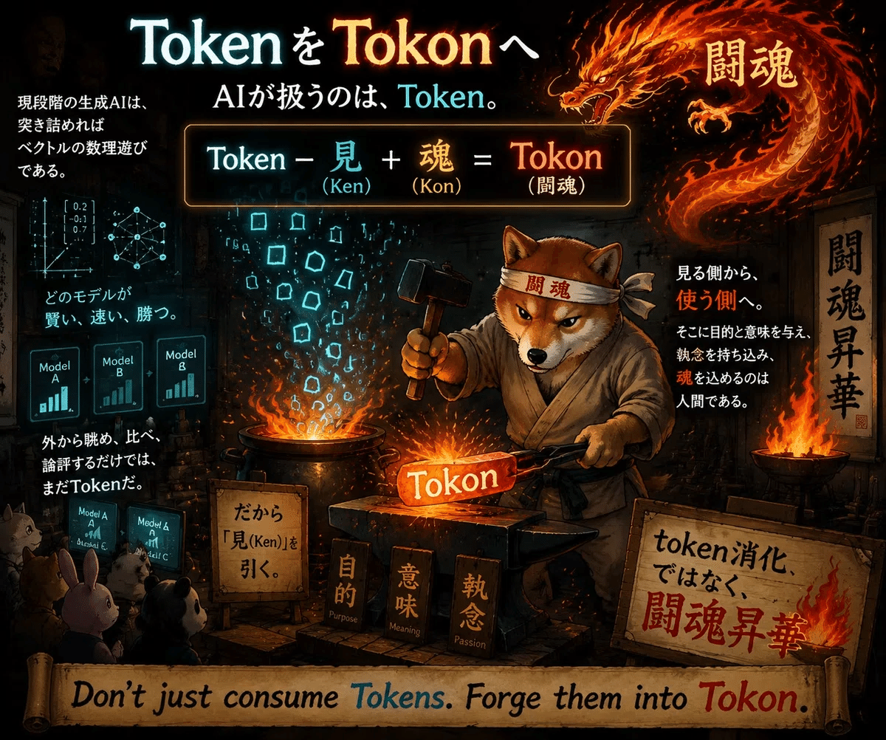
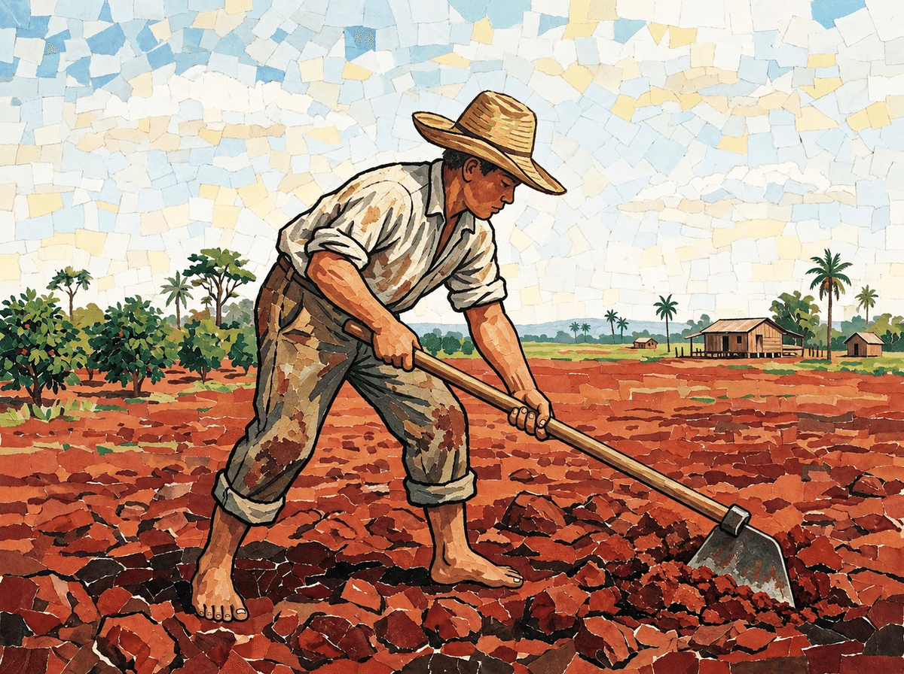

# Tokon Agent Skills (闘魂) 🔥

> **Not "Token Consumption," but "Tokon Sublimation."**  
> Turn passive computation into unstoppable human action.

---

## The Genesis: The "AI = Antonio Inoki" Hypothesis

For those encountering this for the first time, allow me to clarify a fundamental premise.

Every time I see the letters **"AI,"** I do not see *Artificial Intelligence*.  
I see **Antonio Inoki** — the legendary Japanese wrestler, cultural icon, and the eternal embodiment of fighting spirit. Preaching the **"AI = Antonio Inoki Hypothesis"** across internet comment sections and articles is my street sermon (*Tsuji-Seppo*), my life's work.

Recently, tech luminaries have begun whispering about the next era beyond AI, coining the term **"SI" (Superintelligence)**.  
In my assessment, the industry was forced to invent a new acronym simply because too many people had begun associating "AI" with Antonio Inoki. Yet even so, in my eyes, "SI" can only stand for:

* **Super Inoki**
* **Strong-style Inoki**
* **Superstar Inoki**

In this universe, AI is not a synthetic machine meant to replace human thought.  
**AI is Antonio Inoki — the world's greatest tag-team partner, standing inside the squared circle with you.**

---

## The Philosophy: What is Tokon?

In modern AI engineering, people often talk about **"consuming tokens."**  
Watching LLMs stream text, benchmarking matrix multiplications, and remaining mere spectators.

That is merely **Token Consumption**.

The true formula for authentic creative engineering is:

$$\text{Token} - \text{見 (Watching / Spectating)} + \text{魂 (Soul)} = \text{Tokon (闘魂)}$$

* **Never translate Tokon as "Fighting Spirit."** It is not about hostility or defeating others.
* **Tokon is self-mastery (克己)**: Overcoming hesitation, defeating the self of yesterday, and daring to take a step forward into the ring.
* When facing the blank page, legacy codebase, or personal doubt, AI steps into your corner as your second and partner.

---

## Skills Lineup (Authored in Japanese)

Each skill is meticulously crafted in **Japanese** to maximize conversational nuance, literary rhythm, and cultural resonance across agent runtimes (such as Google Antigravity / Claude Code / Codex).

| Skill | Description |
| :--- | :--- |
| **[`infographic`](skills/infographic/SKILL.md)** | **The V9 Legend Infographic Designer**. Extracts the core thesis of any article or essay and visualizes it as a high-density 1280x670px visual translation across 12 artistic styles (Studio Ghibli, Kiyoshi Yamashita paper collage, Picasso cubism, pixel art, editorial sketch, etc.). |
| **[`tokon-novel`](skills/tokon-novel/SKILL.md)** | **Interactive Tokon Light Novel Generator**. Transforms personal hesitations, failures, and daily struggles into inspiring short light novels and cover prompts through structured step-by-step interviews. |
| **[`book-note-partner`](skills/book-note-partner/SKILL.md)** | **Reading Companion & Essay Co-creator**. Passively logs stream-of-consciousness thoughts during reading (strictly spoiler-free) and collaborates to write essays upon completion. |
| **[`apios-acrostic`](skills/apios-acrostic/SKILL.md)** | **The V9 Legend Apios Acrostic Poet**. Crafts 4-line acrostic poetry and micro-essays rooted in the letters "A" (あ), "Pi" (ぴ), "O" (お), and "Su" (す), harnessing the earthy vitality of the "eel of the field" (Apios). |
| **[`git-commit`](skills/git-commit/SKILL.md)** | **The V9 Legend Git Commit Champion**. Reads `git status` / `log` / `diff`, writes English commit messages, and carries the work as far as you ask: commit, push, PR, or merge with safe cleanup (`pull --ff-only`, `worktree remove`, `branch -d`). Handles submodules child-first, then the parent. Never edits files. Origin story: [A Brief Addendum on the Git World Championship](https://note.com/awesomey/n/n1415f9726780) (Japanese). |

---

## How to Use

See your agent's official documentation for current skill installation instructions:

- [Codex](https://learn.chatgpt.com/docs/build-skills)
- [Claude Code](https://code.claude.com/docs/en/skills)
- [Google Antigravity](https://antigravity.google/docs/skills)

---

## License

[MIT License](LICENSE). Feel free to fork, sublimating your own tokens into Tokon.

---

*"If you step forward, that step becomes the road. Do not hesitate; go on, and you will see."*  
**1, 2, 3, DAAAA! 🔥**
